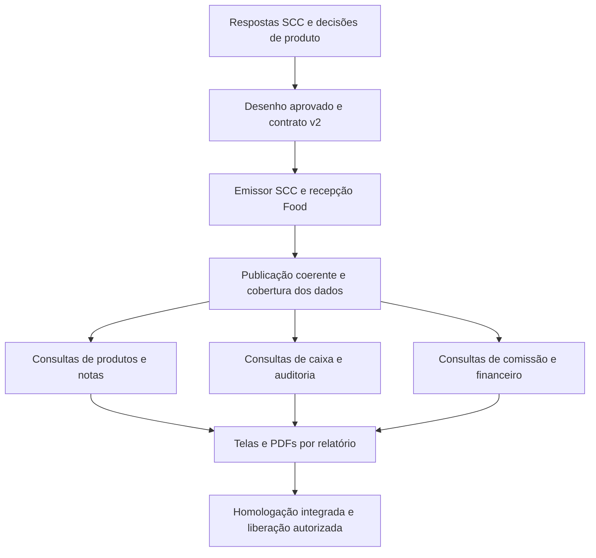

# Seis relatórios — roteiro de preparação da implementação

> **Roteiro histórico, substituído.** O usuário determinou seguir com o material atual e deixar refinamentos para depois. Para executar, usar [seis-relatorios-executar.md](2026-10-28-seis-relatorios-executar.md) e os três planos vinculados. As etapas bloqueantes abaixo não orientam a nova execução.

**Data:** 28/10/2026. **Estado:** roteiro técnico preliminar; não executar como plano fechado.

**Pedido do usuário:** somente planejar. A implementação será feita posteriormente por outro modelo. Este documento organiza entregas, dependências, arquivos e critérios de aceite; não declara resolvidas as fórmulas ou chaves ausentes nos materiais. O plano executável com assinaturas, DDL e testes definitivos será derivado dele após as respostas e aprovação do desenho.

**Análise que acompanha este roteiro:** [materiais, regras e arquitetura proposta](../specs/2026-10-28-seis-relatorios-analise-e-proposta.md).

**Perguntas externas:** [pedido ao Pedro e códigos T01–T11](../../integracao-scc/2026-10-28-perguntas-seis-relatorios.md).

## 1. Instruções para quem retomar

1. Ler `AGENTS.md`, `CLAUDE.md`, a análise e o pedido ao Pedro. Inspecionar o estado/HEAD atual: a análise foi feita em `422eaefdcef606210ac52e9ba8fe5ae7b88a9182` e outro desenvolvedor pode ter avançado o código.
2. Usar o checkout existente. Cada tarefa de nuvem já é isolada; não criar worktree sem pedido explícito. Não reinstalar ferramentas nem refazer a inspeção inteira se as evidências e versões continuarem válidas.
3. Distinguir resposta do usuário, confirmação do Pedro, fato comprovado no SQL e proposta do agente. Uma recomendação neste roteiro não é decisão de produto aprovada.
4. Não implementar neste turno de planejamento; não iniciar código na retomada sem o desenho aprovado. As respostas externas são entradas para o desenho, não autorização para executar SQL no cliente ou publicar no Food.
5. Nunca usar PDFs reais como fixtures ou copiar linhas para código, teste, documentação, issue ou commit. Os arquivos originais estão fora do checkout, em `/workspace/attachments/`; os caminhos podem não existir em outra tarefa. Usar a análise sanitizada e pedir somente o material que de fato faltar.
6. Não inferir identidade por nome, comissão por percentual observado, dia SCC pela abertura da conta, ou débito por sinal sem confirmação. Se faltar uma resposta que afete uma etapa, executar apenas etapa independente já aprovada e registrar o bloqueio específico.

## 2. Requisitos confirmados e propostas pendentes

**Confirmados:** seis relatórios; números/detalhes/filtros conferíveis com SCC; apresentação com a identidade Food; preservação de Hoje/Resultados/Ajustes; contagens por sexo/categoria no Financeiro, agregadas na SCC antes do envio e sem sexo por pessoa; somente planejamento agora. O usuário aceitou avaliar nomes em Notas assinadas, mas não aprovou coleta ou mudança geral da política.

**Propostas para aprovação:** área Relatórios separada; contrato v2 aditivo com endpoint próprio; fatos mínimos e cálculos no banco, com resultado oficial SCC somente se a fórmula não puder ser transferida; período/cobertura e modalidades visíveis; PDF por relatório com mesma leitura da tela.

**Pendências impeditivas:** financeiro completo; cálculo de comissão; operador no caixa; consultas on-line faltantes; chaves/DDL e transição entre tabelas; semântica de datas e decimais. Não prometer que um executor resolverá esses pontos só lendo o repositório.

## 3. Mapa de dependências



Cada relatório pode ser homologado separadamente quando seus dados e regras estiverem completos; a fundação compartilhada vem primeiro. Comissão depende de itens, produtos, pagamentos/formas e operadores, não só do cadastro de garçons. Financeiro depende das consultas de T01 e dos demais conjuntos que elas revelarem. Não tratar a ordem numérica dos PDFs como ordem obrigatória de desenvolvimento.

## 4. Entrega 0 — fechar especificação, sem implementar

**Produz:** desenho aprovado, matriz campo/origem/regra/filtro, política de dados, contrato de sincronização e casos fictícios de homologação.

**Arquivos de planejamento a consolidar após respostas:**

- `docs/superpowers/specs/2026-10-28-seis-relatorios-design.md`: arquitetura e decisões aprovadas, citando a análise.
- `docs/integracao-scc/contrato-de-dados-v2.md`: envelope definitivo, capacidades, fontes, datas, chaves, precisão, limites, códigos de erro e exemplos fictícios.
- Planos executáveis separados para integração, consultas e telas/PDF em `docs/superpowers/plans/`, criados com `writing-plans` depois da aprovação do desenho.

**Passos:**

- [ ] Obter T01–T11 e registrar quais respostas atendem quais bloqueios; uma resposta parcial não fecha todos os códigos.
- [ ] Confirmar a nova área, modalidades on-line/histórica e a política de nomes/textos. As contagens agregadas por sexo/categoria já estão no escopo confirmado; definir o contrato sem dados individuais. Avaliar finalidade, acesso, retenção e papéis de Repply/restaurante/SCC antes de coletar.
- [ ] Para cada relatório definir campos e totais, filtros/defaults, granularidade, origem de cada dado, data usada, regras de arredondamento e estados de cobertura. Confirmar o que muda se cadastro/custo/regra for editado depois.
- [ ] Definir o limite inicial de período/linhas/PDF com base em volume e capacidade, e se consultas anuais serão particionadas ou exigirão outra entrega. O limite de 90 dias de Resultados não pode ser copiado como requisito sem decisão.
- [ ] Decidir nomes e tipos exatos de entidades/contratos só depois de T02/T03/T09. Não criar chave da auditoria por timestamp e não separar duas identidades do mesmo fato só pelo nome da tabela.
- [ ] Decidir o emissor e o leitor em cada lado. Incluir tarefas da SCC explicitamente, com responsável e aceite; a Repply não modifica o banco/Delphi do cliente nesta etapa.
- [ ] Registrar novas decisões em `docs/decisoes.md` de forma aditiva, atualizar `SPEC.md`, política de segurança e métricas somente depois de aprovadas.

**Aceite:** um modelo sem a conversa consegue identificar todas as fórmulas e fontes ou um bloqueio explícito por entrega. Não há lacunas tratadas como suposições silenciosas. Um desenho aprovado não depende de acesso ao banco de produção para ser compreendido.

## 5. Entrega 1 — fundação de ingestão e publicação de dados

Dividir em tarefas testáveis, nesta ordem. Os caminhos abaixo são **propostos** para os planos executáveis, ainda sem implementação.

### 1A. Contrato e validação v2, preservando v1

**Arquivos candidatos:**

- Criar `supabase/functions/_shared/recepcao-v2.ts` para schemas do envelope/conjuntos com tipos exatos e lista explícita.
- Criar `supabase/functions/_shared/campos-permitidos-v2.ts` para filtragem recursiva e política mínima aprovada.
- Criar `lib/validators/recepcao-v2.ts` como reexportação canônica, seguindo o padrão v1.
- Criar `tests/recepcao-v2/schemas.test.ts` e `tests/recepcao-v2/campos-permitidos.test.ts`.

**Aceites de teste:** v1 continua validando só lote `1/1`; v2 não passa pelo reconciliador v1; chaves numéricas grandes são representadas sem perda; decimais de quantidade/custo não são convertidos em `number` para cálculo; datas/conjuntos/chaves fora do contrato falham; nomes/campos pessoais não aprovados somem antes de log/persistência; conjunto ausente não equivale a lista vazia completa.

**Dependências:** Entrega 0, T02/T03/T09; não adotar a mesma escala de dinheiro da conta para custo unitário sem DDL.

### 1B. Persistência de fatos, cadastros e metadados

**Arquivos candidatos:** migrations **novas** separadas para cadastros/fatos, política RLS e controle de sincronização em `supabase/migrations/`. Os timestamps serão escolhidos na execução, verificando migrations concorrentes. Não editar migrations publicadas.

**Grupos de tabelas propostos:** fatos/cadastros mínimos do §5.1 da análise; controle privado de lotes/páginas; manifesto de publicação/cobertura por casa/conjunto/escopo; capacidade e versão do emissor. Nomes finais e chaves dependem do contrato aprovado.

**Testes candidatos:** `tests/isolamento/relatorios-fatos.test.ts`, `tests/isolamento/relatorios-sincronizacao.test.ts`, `tests/recepcao-v2/persistencia.test.ts`. Atualizar listas intencionais em `tests/isolamento/todas-as-tabelas.test.ts`, `funcoes-fechadas.test.ts` e `rpc-privilegada.test.ts` conforme funções reais adicionadas.

**Aceites:** PK e relações incluem a casa e namespace aprovado; tipos e limites exatos; imutabilidade do restaurante; fatos com atualização/reaparecimento e remoção lógica definida; categoria de caixa usa tipo+código; RLS de todo conjunto; área temporária sem leitura pelo cliente; grants de escrita só pelo caminho técnico; índices dos filtros/plano de execução comprovados com massa fictícia.

**Cuidado:** os novos testes de privilégios precisam conferir também os cadastros, filtros e dados de clientes mínimos; não basta proteger a tabela de lançamentos.

### 1C. Recepção fragmentada, finalização e reconciliação

**Arquivos candidatos:** `supabase/functions/receber-envio-v2/index.ts` e `deno.json`; módulos internos pequenos para autenticação, validação de página e respostas; migrations novas para receber/finalizar a geração e limpeza de staging. Registrar `verify_jwt` intencional no `supabase/config.toml`, mantendo autenticação própria por token. Se extrair helper da v1, fazê-lo em tarefa própria com regressão equivalente, sem mudança de regra.

**Testes candidatos:** `tests/recepcao-v2/envio.test.ts`, `lotes.test.ts`, `reconciliacao.test.ts`, `transicao-fontes.test.ts` e `compatibilidade-v1.test.ts`.

**Ciclo obrigatório:** validação → armazenamento privado da página → confirmação da página → checagem do manifesto completo → publicação atômica → confirmação do cursor. Não atualizar o cursor de movimento ao receber a primeira página.

**Casos de aceite:**

- [ ] Retry idêntico depois de confirmação perdida não duplica; conflito de conteúdo com mesmo identificador é rejeitado.
- [ ] Falta da última página, falha de checksum ou de um conjunto dependente preserva a última visão completa e não remove fatos.
- [ ] Publicação antiga atrasada não substitui a recente; gerações e escopos concorrentes não se contaminam.
- [ ] Um dia acima do limite consegue ser dividido internamente; limite considera corpo/bytes e número de registros, não apenas quantidade de contas.
- [ ] Mudança temporário/permanente preserva o fato uma única vez; lacuna de fechamento mostra estado transitório, não zero confirmado.
- [ ] Conta/cadastro ausente não faz a publicação parcial parecer sucesso; regra para dependências é explícita.
- [ ] Histórico pode ser reprocessado por conjunto/período, inclusive correção fora da janela recente.
- [ ] Limites de ritmo v2 protegem o serviço e permitem paginação sem bloquear o fluxo v1.
- [ ] Staging expirado é limpo com segurança e não altera publicações válidas; nomes nunca são incluídos no registro de erro.

Se o mecanismo de publicação optar por versões imutáveis, definir retenção e custo. Se optar por substituir dados ativos, definir como leituras paginadas/PDF mantêm consistência ou detectam mudança e reiniciam. Um token com número de versão, sozinho, não torna linhas mutáveis em snapshot.

### 1D. Emissor SCC, carga inicial e observabilidade

**Responsável externo:** SCC/Pedro. Ler as tabelas, construir fotografia, enviar cadastros/fatos/manifesto por partes, repetir e guardar checkpoints. O Food não consegue criar os fatos que o emissor não manda.

**Arquivos candidatos do Food:** `scripts/gerador-relatorios-ficticios.ts`, módulos pequenos em `scripts/relatorios-ficticios/`; testes `tests/gerador/relatorios-v2.test.ts`; leitor de estado em `lib/admin/sincronizacao-relatorios.ts` e componente de diagnóstico no detalhe da casa. Configuração e token próprios de restaurante local fictício, não da demonstração.

**Aceites:** gerador valida pelo schema canônico; simula on-line/fechamento/histórico e retoma após falha; sem dados reais; carga antiga não impede atualização recente; admin informa capacidades, intervalos cobertos e último sucesso por conjunto; o selo global existente não é usado como prova de que todos os relatórios estão atualizados. Não alterar alarmes atuais sem decisão própria.

## 6. Entrega 2 — leitores e regras por relatório

Criar um leitor e funções SQL específicos por relatório. Evitar acrescentar todas as consultas ao `obterResultados` existente. As assinaturas definitivas devem usar filtros explícitos de casa, datas, fonte e dimensões aprovadas; pagination/snapshot também precisam ser descritos no contrato da consulta.

**Estrutura proposta:**

```text
lib/relatorios/
  filtros-comuns.ts            # datas/fonte e serialização sem nomes pessoais
  estado-dos-dados.ts          # capacidade, cobertura e frescor por dependência
  produtos/{filtros,tipos,leitura}.ts
  comissao/{filtros,tipos,leitura}.ts
  caixa/{filtros,tipos,leitura}.ts
  auditoria/{filtros,tipos,leitura}.ts
  notas-assinadas/{filtros,tipos,leitura}.ts
  financeiro/{filtros,tipos,leitura}.ts
```

Cada leitor só adapta resultados tipados; cálculos financeiros/quantidades/totais ficam em funções SQL `metrica_relatorio_*`. Valores decimais saem como texto; contagens inteiras podem usar tipo seguro conforme volume. Filtros são validados novamente no banco. Resultado e resumo precisam ter a mesma fonte, versão e filtro; total não é soma da página atual.

### 2A. Infraestrutura de consulta, filtros e estado

**Testes:** `tests/relatorios/filtros-comuns.test.ts`, `estado-dos-dados.test.ts`, `isolamento-filtros.test.ts`.

**Aceites:** falta de data nunca consulta tudo; data inválida não vira período padrão silencioso; Todos corresponde a filtro opcional, código exato a seleção; código da casa B é inacessível por A; URL/PDF usam código, não nome; capacidade/cobertura ausente resulta em estado informativo, não resultado financeiro zero; paginação estável com ordenação e desempate definidos.

### 2B. Produtos vendidos

**Arquivos:** pasta `lib/relatorios/produtos/`; migration `metrica_relatorio_produtos`; `tests/relatorios/produtos-sql.test.ts` e `produtos-leitura.test.ts`.

**Casos:** não cancelado e não pago conforme regra recebida; cancelado excluído; quantidade fracionária; ajustes unitários antes da multiplicação; custo do cadastro versus custo histórico conforme T09; filtro pelo garçom do item, PDV/grupo/mesa; subtotais por grupo e totais globais; tratamento explícito de órfãos e zeros. Agrupamento por identidade correta mesmo com nomes repetidos.

**Exemplo fictício de teste a consolidar com escala aprovada:** quantidade `1.250`, unitário `12.40`, acréscimo `0.80`, desconto `0.20` → total exato `16.25`. Custo unitário `3.20` → custo `4.00`; diferença `12.25`. Isso testa a ordem das operações sem usar valores do cliente real. Acrescentar caso que diferencie arredondar por item de arredondar a soma, conforme resposta oficial.

### 2C. Notas assinadas

**Arquivos:** pasta `lib/relatorios/notas-assinadas/`; migration `metrica_relatorio_notas_assinadas`; `tests/relatorios/notas-assinadas-sql.test.ts`.

**Casos:** múltiplas notas/pagamentos/itens por entrada não multiplicam notas; filtro de cliente por código; nome só se a política for aprovada; histórico por movimento; ordenação/desempate estáveis; alteração/baixa/cancelamento conforme T08. Nenhuma regra de inadimplência é adicionada.

**Bloqueio próprio:** política P01 e T08. Não implementar coleta de nomes só porque o usuário aceitou avaliá-la.

### 2D. Caixa

**Arquivos:** pasta `lib/relatorios/caixa/`; migration `metrica_relatorio_caixa`; `tests/relatorios/caixa-sql.test.ts`.

**Casos:** tipo+código da categoria; operador correto; agrupamento por data civil conservando data de movimento; sinal de débitos conforme T06; estorno e valor zero; total dos lançamentos filtrados sem somar pagamentos de vendas por fora.

**Bloqueio próprio:** T06. Não extrair o operador do campo credor/devedor nem do nome do operador que imprimiu o PDF.

### 2E. Auditoria

**Arquivos:** pasta `lib/relatorios/auditoria/`; migration `metrica_relatorio_auditoria`; `tests/relatorios/auditoria-sql.test.ts`.

**Casos:** todos os cinco tipos, transferência parametrizada, produto ausente preservado, limites antes/depois, duas ocorrências iguais com chaves diferentes, dados privados filtrados, totais por tipo sem inventar perda total. Fonte on-line e histórica seguem o mesmo contrato de filtros aprovado, com diferenças intencionais documentadas.

**Bloqueio próprio:** T07. Não deduzir auditoria a partir de `removida_em` da conta ou do consumo cancelado.

### 2F. Comissão

**Arquivos:** pasta `lib/relatorios/comissao/`; migration de consulta e cálculo/resultado oficial conforme T04; `tests/relatorios/comissao-sql.test.ts`.

**Casos:** elegibilidade por produto e pagamento; conta paga; operador do item; pagamento misto bloqueando conta inteira se a SCC confirmar; operadores zerados; funções completas; arredondamento/vigência. Vendas elegíveis e comissão são valores distintos. Taxa de serviço do ranking existente não é usada como substituto.

**Bloqueio próprio:** T04. O plano executável precisa dizer se implementa a fórmula homologada ou lê resultado oficial do emissor e quais filtros esse resultado comporta.

### 2G. Resumo financeiro

**Arquivos:** pasta `lib/relatorios/financeiro/`; funções de consulta separadas por blocos, agrupadas sob manifesto/versão coerente; `tests/relatorios/financeiro-sql.test.ts`.

**Casos:** componentes isolados; recebimentos mistos; notas/descontos; taxas/embutidos/flyers; contagens agregadas por sexo/categoria sem vínculo individual e rejeição de sexo por pessoa; janela da madrugada; diferenças legítimas e equações de reconciliação confirmadas pela SCC. Projetado SCC não é a projeção mensal do Hoje.

**Bloqueio próprio:** T01. Não inventar o bloco financeiro usando apenas a soma de `ValorConsumido`.

Após cada relatório aprovado, atualizar `docs/metricas.md` ou documento específico referenciado por ele, com fórmula e exemplo fictício. Gerar `types/database.types.ts` pelo script do projeto no ambiente local quando o modelo definitivo existir; esse passo pertence à implementação, não a este planejamento.

## 7. Entrega 3 — área Relatórios, telas e PDF

**Rotas propostas, sujeitas à aprovação da navegação:**

- `app/r/[slug]/relatorios/page.tsx`: catálogo dos seis relatórios e disponibilidade por casa.
- `app/r/[slug]/relatorios/[relatorio]/page.tsx`: despacho por lista fechada de relatórios; guarda de acesso antes da leitura.
- `app/r/[slug]/relatorios/[relatorio]/pdf/route.ts`: PDF autenticado com mesmos filtros/versão; relatório inválido não vira seleção de tabela ou SQL dinâmico.

**Componentes propostos:** `components/painel/relatorios/` com catálogo, filtros comuns, estado, paginação e componentes por relatório. Alterar `components/painel/menu-painel.tsx` e seus testes apenas com navegação aprovada; considerar tanto lateral quanto menu inferior de celular. Não introduzir dez abas carregadas ao mesmo tempo.

**PDF proposto:** `lib/pdf/relatorios/` com documento base e seis documentos próprios, mantendo `lib/pdf/resultados.tsx` e a rota antiga com o comportamento atual. Reutilizar `@react-pdf/renderer`; não acrescentar outra biblioteca sem necessidade medida.

**Testes propostos:** `tests/componentes/relatorios/`, `tests/relatorios/rotas.test.ts`, `tests/pdf/relatorios.test.tsx`; ampliar `tests/painel/menu-painel.test.tsx`, `tests/painel/modo-leitura.test.tsx` e testes de acesso conforme superfícies alteradas.

**Aceites de interface:**

- [ ] Mesmos filtros e informações numéricas da SCC, com as diferenças aprovadas documentadas, na identidade Food.
- [ ] Datas preenchidas explicitamente e validadas; campos opcionais Todos; filtros dependentes coerentes; não consultar sem período válido.
- [ ] Celular mostra o mesmo conteúdo relevante que computador, com detalhes expansíveis quando necessário, claro e escuro; operar com teclado/leitor de tela.
- [ ] Sem movimento é distinto de histórico incompleto e conjunto não recebido; mostrar atualização por dependências do relatório.
- [ ] Link direto, recarregamento e voltar/avançar conservam filtros. Nomes pessoais não são colocados na URL ou armazenamento persistente do navegador.
- [ ] Admin vê a mesma análise permitida, com faixa de leitura e sem editar os dados SCC.
- [ ] PDF preserva casa, fonte, período, filtros, data de extração, cobertura, cabeçalhos repetidos e todas as linhas autorizadas dentro do limite.
- [ ] Nenhum código é cortado por quebra de coluna; nomes longos fictícios, quantidade fracionária e valores grandes são legíveis.
- [ ] Nenhum truncamento padrão da API ou paginação é omitido do documento. Se exceder o limite aprovado, o erro orienta um recorte antes de gerar um documento incompleto.
- [ ] Página e PDF não somam valores em ponto flutuante nem recalculam comissão; leem as funções homologadas.
- [ ] Exporte por versão coerente ou informe/reinicie ao detectar mudança; não combinar páginas de movimentos distintos durante fechamento.

## 8. Entrega 4 — desempenho, homologação e liberação

**Pré-condição:** serviços locais reais disponíveis. Retomar o diagnóstico de ambiente se necessário; na sessão anterior o registro de imagens Supabase esteve bloqueado. Não usar produção para substituir testes locais, não executar `supabase db reset` para corrigir fixtures e não declarar pronto com suíte de integração indisponível.

**Passos de homologação:**

- [ ] Emissor e Food processam a massa fictícia T11 nos dois modos e após fechamento/reabertura.
- [ ] Conferir linhas, grupos, totais e filtros de cada relatório contra a saída oficial SCC. Usar igualdade decimal exata depois do arredondamento oficial; nenhuma tolerância arbitrária para dinheiro.
- [ ] Testar histórico incompleto/correção antiga e atualização atual simultâneos, mais isolamento A/B com códigos iguais.
- [ ] Fazer teste de volume representativo e medir consulta, memória/tempo de PDF, custo de carga e armazenamento. Definir limites finais com evidência; evitar consulta/arquivo anual gigante síncrono sem medição.
- [ ] Se consultas longas excederem limites, desenhar entrega própria de exportação assíncrona com fila persistente, autenticação no download, expiração e isolamento. Não usar `setInterval` ou memória da Vercel como fila.
- [ ] Conferir tipos, `npm run check`, `npm run test` com testes SQL/HTTP reais e `NEXT_PUBLIC_APP_URL=http://127.0.0.1:3000 npm run build`; inspecionar os relatórios em celular/computador e os PDFs gerados.
- [ ] Revalidar Hoje/Resultados/Ajustes, PDF antigo, login/admin, recebimento v1, selo e privacidade do PWA. Concluir somente com evidência atual; separar falha de infraestrutura de defeito de código.
- [ ] Preparar procedimento de aplicação aditiva, emissor compatível e liberação por capacidade/homologação da casa. Reverter exposição da nova área sem apagar fatos ou quebrar o v1 se houver problema.
- [ ] Pedir autorização específica antes de alterar produção ou publicar; push em `main` já publica o frontend. Alteração do banco e atualização do emissor são passos distintos, com plano de reversão compatível, sem excluir dados do cliente.

**Fora desta entrega:** gestão de recebíveis, pagamento de comissão, edição de lançamentos, alteração do SCC pelo painel, mentor IA, novo modelo de cargos, exportação CSV/Excel e redefinição dos números atuais do Hoje. Esses itens não são necessários para ler os seis relatórios fornecidos.

## 9. Pacote que deverá acompanhar o modelo executor

Antes de trocar para execução, reunir:

1. Desenho aprovado e decisões registradas, inclusive exceções de privacidade.
2. Contrato v2 fechado com exemplos fictícios, chaves/decimais/fontes e erros.
3. Respostas T01–T11 e fórmulas oficiais; nenhum arquivo real de cliente versionado.
4. Planos executáveis em unidades pequenas com arquivos, assinaturas, testes TDD, comandos e critérios de revisão. Separar plano de integração, de consultas e de UI/PDF; não exigir que o modelo econômico resolva arquitetura sem contexto.
5. Massa fictícia de homologação e valores esperados por relatório/filtro/estado.
6. Responsável/entrega SCC e dependências do ambiente local; limites de publicação autorizada.

**Prompt de retomada recomendado enquanto faltarem respostas:**

> Leia a análise e o roteiro dos seis relatórios de 28/10/2026 e as perguntas T01–T11. Estamos apenas planejando. Incorpore as respostas novas, aponte o que continua bloqueado e consolide o desenho; não implemente, não execute SQL dos anexos e não copie dados reais para o repositório. Depois da aprovação do desenho, prepare os planos executáveis para outro modelo.
